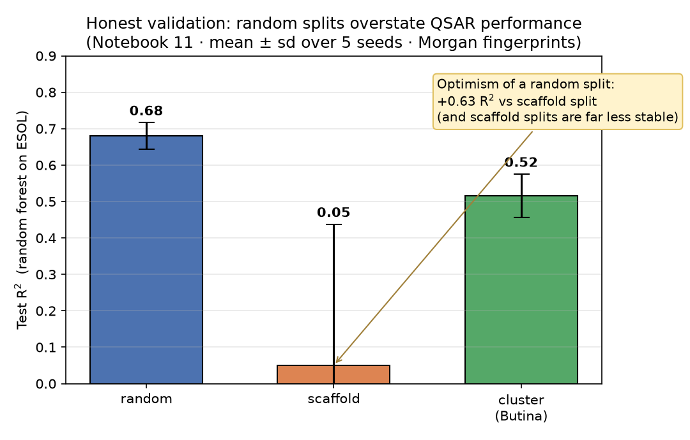

# Practical Cheminformatics Course

**A hands-on, 12-notebook course that takes you from Python basics to building, validating, and deploying QSAR models and virtual screens — all in your browser with Google Colab.**

[](https://github.com/hentablihamza/practical-cheminformatics-course/actions/workflows/ci.yml)
[](https://www.python.org)
[](https://colab.research.google.com/github/hentablihamza/practical-cheminformatics-course/blob/main/notebooks/01_python_pandas_for_chemists.ipynb)

Every notebook runs end to end on free [Google Colab](https://colab.research.google.com) with **one click** — no installation, no setup. Each one uses **small, real, public datasets** (Delaney ESOL solubility, curated ChEMBL bioactivity) so you learn on the kind of data you will actually meet, and never on invented numbers.



*From Notebook 11: a random train/test split overstates QSAR performance by +0.63 R² on this dataset. Honest validation is one of the course's recurring themes.*

## Who this is for

- **Chemistry / biology students and Ph.D. researchers** starting in computational drug discovery.
- **Experimental chemists** who want to analyze their own compound and assay data.
- **Programmers** entering cheminformatics who want a chemistry-grounded tour of RDKit and scikit-learn.

You need only basic Python. Notebook 01 covers the pandas you need; everything else is taught as it appears.

## Syllabus

Click a badge to open that notebook in Colab, or browse the [`notebooks/`](notebooks) folder.

| # | Notebook | You will learn to… | Colab |
|---|----------|--------------------|-------|
| 01 | Python & pandas for chemists | load, filter, group, and plot a molecular dataset | [](https://colab.research.google.com/github/hentablihamza/practical-cheminformatics-course/blob/main/notebooks/01_python_pandas_for_chemists.ipynb) |
| 02 | RDKit basics | turn SMILES into molecules, inspect atoms/bonds, draw, canonicalize | [](https://colab.research.google.com/github/hentablihamza/practical-cheminformatics-course/blob/main/notebooks/02_rdkit_basics.ipynb) |
| 03 | Descriptors & drug-likeness | compute MW/logP/TPSA, apply Lipinski, Veber, QED | [](https://colab.research.google.com/github/hentablihamza/practical-cheminformatics-course/blob/main/notebooks/03_descriptors_druglikeness.ipynb) |
| 04 | Fingerprints & similarity | Morgan/MACCS fingerprints, Tanimoto, similarity search | [](https://colab.research.google.com/github/hentablihamza/practical-cheminformatics-course/blob/main/notebooks/04_fingerprints_similarity.ipynb) |
| 05 | Substructure search & SMARTS | match substructures, write SMARTS, flag PAINS | [](https://colab.research.google.com/github/hentablihamza/practical-cheminformatics-course/blob/main/notebooks/05_substructure_smarts.ipynb) |
| 06 | Standardization & curation | clean structures, harmonize units, deduplicate, aggregate replicates | [](https://colab.research.google.com/github/hentablihamza/practical-cheminformatics-course/blob/main/notebooks/06_standardization_curation.ipynb) |
| 07 | Getting data from ChEMBL | query the ChEMBL REST API, paginate, handle failures | [](https://colab.research.google.com/github/hentablihamza/practical-cheminformatics-course/blob/main/notebooks/07_chembl_data_access.ipynb) |
| 08 | Chemical space visualization | PCA, t-SNE, UMAP; compare dataset coverage | [](https://colab.research.google.com/github/hentablihamza/practical-cheminformatics-course/blob/main/notebooks/08_chemical_space_visualization.ipynb) |
| 09 | Clustering & scaffolds | Murcko scaffolds, Butina clustering, diverse subsets | [](https://colab.research.google.com/github/hentablihamza/practical-cheminformatics-course/blob/main/notebooks/09_clustering_scaffolds.ipynb) |
| 10 | Your first QSAR model | train/evaluate a random forest, baselines, parity plots | [](https://colab.research.google.com/github/hentablihamza/practical-cheminformatics-course/blob/main/notebooks/10_first_qsar_model.ipynb) |
| 11 | Honest validation | random vs scaffold vs cluster splits, data leakage | [](https://colab.research.google.com/github/hentablihamza/practical-cheminformatics-course/blob/main/notebooks/11_honest_validation_splits.ipynb) |
| 12 | Virtual screening & enrichment | rank libraries, enrichment factor, BEDROC, ROC | [](https://colab.research.google.com/github/hentablihamza/practical-cheminformatics-course/blob/main/notebooks/12_virtual_screening_enrichment.ipynb) |

Each notebook has clear **learning objectives**, explanations in Markdown, runnable code, and **exercises with collapsible solutions**. Work them in order — later notebooks reuse ideas and data from earlier ones.

## How to use it

### Option 1 — Google Colab (recommended, nothing to install)

Click any **Open in Colab** badge above. The first cell installs the dependencies and downloads the course data automatically.

### Option 2 — Run locally

```bash
git clone https://github.com/hentablihamza/practical-cheminformatics-course.git
cd practical-cheminformatics-course

# with conda
conda env create -f environment.yml
conda activate practical-cheminformatics-course

# or with pip
pip install -r requirements.txt

jupyter notebook   # open the notebooks/ folder
```

All notebooks run **offline** except Notebook 07, which queries the live ChEMBL API and automatically falls back to a cached copy in [`data/chembl_cache/`](data/chembl_cache) when there is no internet.

## Datasets

Small, real, public datasets are committed under [`data/`](data) with full provenance in [`data/README.md`](data/README.md):

- **Delaney ESOL** aqueous solubility (1,128 compounds) — notebooks 01–05, 10–11.
- **Curated EGFR inhibitors** from ChEMBL 37 (6,871 compounds) — notebooks 03–05, 08–12.
- A small **ChEMBL acetylcholinesterase** extract for the offline cache — notebooks 06–07.

No results in this course are invented. ChEMBL data are used under CC BY-SA 3.0 (see [`data/README.md`](data/README.md) for citations).

## Related open-source tools

This course is part of a small ecosystem of cheminformatics tools you can use on your own projects:

- **[chem-curate](https://github.com/hentablihamza/chem-curate)** — reproducible bioactivity and structure curation (the ideas behind Notebook 06).
- **[chembl-easy](https://github.com/hentablihamza/chembl-easy)** — one-command clean, ML-ready ChEMBL downloads (the ideas behind Notebook 07).
- **[qsar-split-bench](https://github.com/hentablihamza/qsar-split-bench)** — benchmark random, scaffold, cluster, and time splits (the ideas behind Notebook 11).

## Author

**Hamza Hentabli, Ph.D.** — AI/ML drug discovery & cheminformatics scientist, and former teacher who has mentored Ph.D. and master's students. This course distills that teaching into material anyone can run.

- GitHub: [@hentablihamza](https://github.com/hentablihamza)
- Google Scholar: [publications](https://scholar.google.com/citations?user=-7dUlnMAAAAJ)
- ORCID: [0000-0002-9530-2815](https://orcid.org/0000-0002-9530-2815)

If these materials help your work or teaching, please cite them (see [`CITATION.cff`](CITATION.cff)). Issues and suggestions are welcome.
